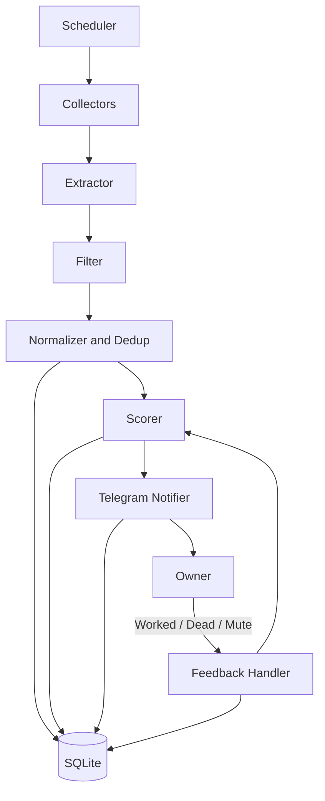

# Hunter: Claude Guest-Pass Referral Monitor — Design

Status: agreed (design interview completed 2026-11-17). No code written yet.

## 1. Purpose

Detect newly posted Claude guest-pass referral links (`https://claude.ai/referral/<code>`) on public sources within seconds to minutes of posting, and alert **one person** (the owner) via Telegram so they can open the link and redeem it manually.

Links are first-come-first-served and are usually claimed within minutes, so **latency and dedup** matter most.

## 2. Ground rules (settled decisions)

| Area | Decision |
|---|---|
| Audience | Owner only. Private Telegram chat. No public or shared channel, no forwarding to others. |
| Action | **Alert only.** No auto-claiming, no logged-in sessions, no multiple accounts. |
| Eligibility | Owner has never had a paid Claude plan or free trial (required by the Guest Pass Terms). |
| Access | Official APIs, public feeds and public pages only. Respect `robots.txt` and ToS. No scraping behind logins, no bot-protection evasion, no user-token automation. |
| Budget | $0. No paid APIs. |
| Stack | Python 3.12, asyncio, SQLite, single long-lived process, Docker Compose. Develop locally (Docker/WSL), move to a VPS later. |
| Validation | **No validator.** There is no known logged-out way to tell if a link is still redeemable (see §3). Confidence comes from age, corroboration and author/source history. |

## 3. Research findings that shaped the design

Verified or sourced during the design interview (as of 2026-11-17). Re-verify before relying on them.

**Program and terms**
- Anthropic calls it a "guest pass": 7 days of Claude Pro for the recipient, limited, first-come-first-served, no cash value, non-transferable, may expire or be withdrawn. Recipients must be new to paid Claude and to free trials, and must enter a card (the trial auto-converts).
- Guest Pass Terms: senders must not sell passes, post them on coupon, deal or referral-exchange sites, or distribute them in bulk or by automated means. Redeeming through an account you control is not allowed. Fraud and multi-account abuse can lead to revocation or suspension.
- Pass counts and Max-only vs Pro eligibility differ between sources. Treat as unknown.
- Whether a sender has one reusable link or several single-use links is disputed between sources. Dedup logic must not depend on the answer.

**Link format**
- `https://claude.ai/referral/<code>`, with a code of about 10 characters (alphanumeric plus `_`; `-` untested). Confirm against real examples before hardcoding the pattern, and keep it configurable.

**Validity**
- No documented or observed logged-out signal distinguishes claimed, expired and live links. A page that loads is **not** proof a pass remains. Only redemption proves validity, which is out of scope.

**Source access (summary)**
- Reddit: API closed to new builders (new access closed 31 Oct 2026; unauthenticated `.json` reportedly 403; RSS ended). **Dropped.**
- X: best signal but paid (pay-per-use) and scraping is prohibited by ToS. **Skipped** (disabled stub only).
- Bluesky: Jetstream firehose, free, no server-side URL filter (client-side substring match).
- Lemmy: search API returns JSON without auth. A Lemmy instance mirrors r/ClaudeCode, which is the likely upstream origin. The mirror may be stale.
- Hacker News: Algolia `search_by_date`, free, low yield.
- Mastodon, GitHub: free, low yield (phase 2).
- Telegram: no worthwhile public channel with direct links found. `t.me/s/<handle>` public preview can be polled without an account. MTProto needs a phone number and risks bans (phase 2, throwaway account).
- Aggregators: `claudecoworkcourse.com/claude-guest-passes` (robots allows `/`, relative timestamps, no feed), `1parrainage.com` Claude page (date only, robots/ToS not yet verified), `claudecoupons.com` (codes never public, not monitorable).
- Discord (user token), YouTube, Facebook, Quora, Google Alerts: excluded (forbidden, no API, or too slow).

**Expectation:** without X, supply is thin and many alerts will be stale or already claimed. This is a tripwire, not a guarantee.

## 4. Architecture

Each stage is its own module. A new source is one new collector implementing a common interface.

### 4.1 Collectors

Each collector:
- Emits a common `RawItem` (source, item id, author, text, urls, permalink, posted-at, fetched-at).
- Keeps a persistent cursor so it only processes new items.
- Has its own interval (with jitter), exponential backoff on errors and 429s, and a per-source enable flag.
- Uses a conditional request or ETag where the source supports it.

| Collector | Method | Interval | Phase |
|---|---|---|---|
| Lemmy | Search API for `claude.ai/referral`, sorted new | 30s | 1 |
| Bluesky | Jetstream firehose, client-side substring match | continuous | 1 |
| Hacker News | Algolia `search_by_date` | 60s | 1 |
| claudecoworkcourse | Poll directory page, parse codes and relative times | 3–5 min | 1 |
| 1parrainage | Poll Claude page. **Gated** on a manual robots.txt/ToS review. | 3–5 min | 1 (gated) |
| Telegram preview | `t.me/s/<handle>`, empty seed list by default | 15s per channel | 1 |
| Mastodon | Public/hashtag streams | stream or 60s | 2 |
| GitHub | Search API (authenticated), low rate | 60s | 2 |
| Lemmy (more communities) | Additional communities or instances | 30s | 2 |
| Telegram MTProto | Throwaway account, read-only, push events | push | 2 |
| X | Disabled stub only | n/a | n/a |

### 4.2 Extractor

- Pulls candidate URLs from text, link fields and expanded Markdown or HTML.
- Matches the referral URL pattern strictly (config-driven).

### 4.3 Filter

Alert only if all of these hold:
- A **direct** `claude.ai/referral/<code>` link is present.
- The host exactly matches `claude.ai` (no lookalike domains, no unicode tricks).
- No URL shorteners or redirect hops are followed.
- The post does not ask for payment or push to a DM/channel (keyword and heuristic checks, kept simple and testable).
- Post age is within the **staleness cutoff** (default 30 minutes, configurable).
- The author and source are not auto-muted.

### 4.4 Normalizer and dedup

- Canonical key: the referral code, case preserved. Tracking params are stripped.
- One alert per code. Every sighting is still stored for corroboration counts.
- A code re-posted after 24 hours gets a new alert only if it was not marked ❌ Dead. ✅ Worked means never re-alert.
- Does not assume one link per sender or many.

### 4.5 Scorer

Score = source trust × freshness decay × corroboration boost × author history.

- The score **never drops** a link that passed the filter. It controls notification behavior:
  - High score: normal notification.
  - Low score: sent silently (`disable_notification`).
- Confidence tag by age: 🟢 under 5 min, 🟡 5–15 min, 🟠 15–30 min.
- Feedback adjusts source and author scores.
- **Auto-mute**: an author is muted after 3 ❌ Dead votes in a row. A source is muted when its dead rate is at least 70% over at least 5 votes. `/unmute` lifts either.

### 4.6 Telegram notifier

- Bot created by the owner via @BotFather. Token in `.env`.
- First-run step captures the owner's chat ID and **locks the bot to that chat only**. All other chats are ignored.
- Alert contents: link, age, source name with permalink, number of sources that posted it, confidence tag. Link preview disabled.
- Inline buttons: ✅ Worked, ❌ Dead, 🔇 Mute source.
- Commands: `/pause`, `/resume`, `/stats`, `/sources`, `/unmute`.
- Respects Telegram rate limits, with retry and backoff and a send queue.

### 4.7 Feedback handler

Processes button callbacks, writes votes to SQLite, updates scores and mutes, and edits the original message to show the recorded outcome.

### 4.8 Ops and monitoring

- Docker Compose, single service, SQLite on a volume. Secrets in `.env` (not committed; `.env.example` provided).
- Daily heartbeat message ("alive", counts, source health).
- Alerts to the owner if a source has errored for over 10 minutes or been silent for 24 hours.
- Structured logs. Graceful shutdown with cursor persistence.

## 5. Data model (SQLite)

| Table | Purpose | Key fields |
|---|---|---|
| `sources` | State per collector | name, enabled, cursor, last_poll, error_count, muted, score |
| `authors` | Author history | source, handle, score, muted, consecutive_dead |
| `links` | One row per referral code | code (unique), first_seen, last_seen, status, feedback |
| `sightings` | Every observation | link, source, author, permalink, posted_at, fetched_at |
| `alerts` | What was sent | link, sent_at, message_id, silent, confidence |
| `votes` | Owner feedback | link, vote, voted_at |

## 6. Configuration

`config.yaml` (non-secret): per-source enable flag and interval, staleness cutoff, referral URL pattern, scoring weights and thresholds, auto-mute thresholds, heartbeat time, Telegram seed channel handles.

`.env` (secrets): Telegram bot token and any optional API keys (for example GitHub token).

## 7. Testing strategy

- Unit tests: extraction, URL validation and normalization, filter rules, dedup and re-alert rules, scoring, auto-mute.
- Fixtures: realistic sample posts, including scam funnels, lookalike domains and shorteners.
- Collectors: tested against recorded responses. No live network in unit tests.
- `--dry-run`: runs the full pipeline and prints alerts instead of sending them.
- `--replay <file>`: feeds saved posts through the pipeline for repeatable end-to-end checks.

## 8. Risks and open items

- **Thin supply without X.** Expect low volume and stale links.
- **ToS drift.** Anthropic's terms, the program itself, and source terms can change. Re-verify periodically.
- **Link format drift.** Pattern is config-driven for this reason.
- **Lemmy mirror staleness.** Verify the mirror is still updating before depending on it.
- **1parrainage.** Must manually read robots.txt and ToS before enabling.
- **Telegram MTProto (phase 2).** Ban risk. Use a throwaway account, read-only, public channels only.
- **Scam and phishing content.** Strict host allowlist, no redirect-following, and the owner's ❌ feedback.
- **Policy line.** The tool is for the owner's personal use. Do not add auto-redemption, multi-account behavior, or any public redistribution of links.

## 9. Out of scope

Auto-claiming, logged-in browser automation, multiple accounts, public or shared channels, Reddit, X, Discord, link selling or trading, validity checks via redemption.

## 10. Reference

- Prior art to study read-only (not fork): `icksannugrahaa/claude-referral-hunter` on GitHub. It includes X scraping, which this project avoids.
